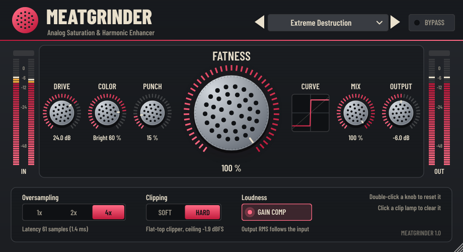

# MEATGRINDER — Analog Saturation & Harmonic Enhancer

A VST3 audio effect for making synths, basses, drums, leads, vocals and full mixes **fatter, louder, denser and
more aggressive** — from subtle analog warmth to EDM / hardstyle-grade destruction. Original design, original
branding, original DSP (inspired only by the *idea* of a "fattener"; no code or artwork from any other product).



---------------------------------------------------------------------------------------------------

## 1. Get the plugin

Requirements: CMake ≥ 3.22, a C++17 compiler (Visual Studio 2022 / Xcode / GCC or Clang), Git.
JUCE is downloaded automatically (or pass `-DMEATGRINDER_JUCE_PATH=/path/to/JUCE`).

```bash
cmake -B build -DCMAKE_BUILD_TYPE=Release
cmake --build build --config Release --target MeatGrinder_VST3 --parallel
```
The result is `build/MeatGrinder_artefacts/Release/VST3/MEATGRINDER.vst3`.
Add `-DMEATGRINDER_COPY_PLUGIN=ON` to copy it into your system VST3 folder automatically.

Linux needs: `libasound2-dev libx11-dev libxcomposite-dev libxcursor-dev libxext-dev libxinerama-dev
libxrandr-dev libxrender-dev libfreetype-dev libfontconfig1-dev libgl1-mesa-dev`.

### Install
| OS      | Copy `MEATGRINDER.vst3` to                                  |
|---------|-------------------------------------------------------------|
| Windows | `C:\Program Files\Common Files\VST3\`                       |
| macOS   | `/Library/Audio/Plug-Ins/VST3/` (or `~/Library/Audio/Plug-Ins/VST3/`) |
| Linux   | `~/.vst3/`                                                  |

Then rescan plugins in your DAW (FL Studio: *Options → Manage plugins → Find installed plugins*).
On macOS, if Gatekeeper blocks an unsigned build: `xattr -cr MEATGRINDER.vst3` and
`codesign --force --deep --sign - MEATGRINDER.vst3`.

---------------------------------------------------------------------------------------------------

## 2. Controls

| Control      | What it does |
|--------------|--------------|
| **FATNESS**  | Saturation intensity *and* harmonic density. Three stages fade in as you turn it up: warm tanh + even harmonics (always on) → symmetric density saturation (from 10 %) → clipper (from 55 %). Also drives the harmonic exciter. |
| **COLOR**    | Tonal character of the distortion, warm/dark ⟷ bright/edgy. Moves five things at once: pre-emphasis (what hits the saturator hardest), knee hardness, even-vs-odd harmonic balance, post tone, and exciter amount. 50 % = neutral. |
| **DRIVE**    | 0 – 36 dB of gain into the nonlinear stages: how hard they are driven. Raise it for quiet material. |
| **PUNCH**    | Left = **density** (crest-factor compressor, fast attack). Right = **transient preservation** (the drive is ducked on onsets so attacks stay crisp while the body gets fat). 50 % is a mix of both. |
| **MIX**      | Dry/wet, with the dry path delay-compensated to the oversampler (no comb-filtering). |
| **OUTPUT**   | −24 … +12 dB, after the mix. |
| **Oversampling** | 1x / 2x / 4x linear-phase. Latency is reported to the host. |
| **Clipping** | SOFT (soft-knee ceiling) or HARD (flat-top clipper). |
| **GAIN COMP**| Slow RMS match (300 ms) of the processed signal to the input, so you can judge the *sound*, not the loudness. |
| **BYPASS**   | Click-free (12 ms crossfade); also mapped to the host's bypass. |
| **Meters**   | Stereo input/output peak meters with latched clip lamps (click a lamp to clear). |
| **CURVE**    | Live view of the actual transfer curve for the current FATNESS / COLOR / DRIVE / clip mode. |

### Factory presets
Init · Warm Glue · Fat Bass · Punchy Drums · Dirty Synth · Screaming Lead · EDM Bus · Hardstyle Kick ·
Sub Thickener · Vocal Presence · Extreme Destruction. (They are also exposed to the host as "programs".)

---------------------------------------------------------------------------------------------------

## 3. How it works

```
in ─ DRIVE ─ density compressor ─ transient duck ─ COLOR pre-emphasis ─ ▲ upsample (1/2/4x FIR)
      ┌──────────── oversampled ─────────────────────────────────────────────────────────────┐
      │ A tanh warmth + even harmonics → B density → C clipper  (+ harmonic exciter)           │
      │ → DC blocker → ceiling (soft knee or hard)                                              │
      └───────────────────────────────────────────────────────────────────────────────────────┘
   ▼ downsample ─ DC blocker ─ COLOR post tone ─ RMS gain-comp ─ safety ceiling
   ─ MIX with latency-aligned dry ─ OUTPUT ─ bypass crossfade ─ runaway guard (+18 dBFS, NaN-safe)
```
* **Stereo imaging is preserved**: the nonlinear stages run per channel, but every control signal
  (compressor, transient detector, gain-comp) is *linked*, so a loud and a quiet side get the same gain.
* **No zipper noise**: all parameters are smoothed (30 ms; 12 ms for bypass); coefficients update every 32 samples.
* **DC-safe**: the asymmetric (even-harmonic) stage is DC-blocked *inside* the oversampled stage, before the ceiling.
* **Cheap**: worst case (4x, FATNESS 100 %, stereo, 44.1 kHz) ≈ **2 % of one CPU core** (1.7–2.5 % depending on compiler flags).
* All DSP lives in `Source/MeatGrinderEngine.*` and depends only on JUCE's `dsp` module — it has no GUI code and is unit-tested.

### Verified
**Plugin host validation — [pluginval](https://github.com/Tracktion/pluginval) 1.0.4, strictness 10 (maximum), Linux VST3 build: SUCCESS.**
25 test groups, including open/close (cold + warm), editor open while processing, editor automation, audio processing,
state save/restore, automation, background-thread state, parameter thread-safety, bus layouts and parameter fuzzing.
(That run found and fixed one real bug: a boolean parameter left at an off-grid value by a host was not restored exactly.)

**DSP — run `MeatGrinderDspTests`; 29 checks, all pass:**

| Check | Result |
|-------|--------|
| Latency 1x / 2x / 4x | 0 / 49 / 61 samples (0 / 1.1 / 1.4 ms @ 44.1 kHz), dry path aligned to 0.0 error |
| 54 extreme configs (+12 dBFS noise, FATNESS 100 %, DRIVE +36, every mode) | all finite, wet never above 0 dBFS |
| DC offset (even-harmonic settings, FATNESS up to 100 %) | DC/RMS = 0.004 |
| FATNESS 0 → 100 % at matched loudness (GAIN COMP on) | THD 0.6 % → 43.9 %, loudness within 0.1 dB → the change is timbral, not volume |
| COLOR warm → bright | pink-noise HF share −13.7 → −1.1 dB; bass-saw HF share −25.5 → −18.0 dB; H2−H3 balance −10.7 → −51.8 dB |
| Aliasing, 5 kHz sine, typical settings | −12.5 dB (1x) → −29.8 dB (2x) → −34.3 dB (4x) |
| Stereo | hard-panned input keeps the other channel silent; identical L/R stays identical |
| Gain comp (−30 dBFS noise, FATNESS 70 %, DRIVE +18) | output RMS within 0.02 dB of input (patch is +30.9 dB louder without it) |
| −36 dBFS sine | THD 0.5 % at defaults, 13 % with DRIVE +24 / FATNESS 60 % — quiet material is still usable |

### Limitations — please read
* **Windows / macOS builds are compiled by CI, not by me.** I compiled, ran and pluginval-validated the Linux build only,
  and I have not loaded the plugin into a real DAW. Run pluginval (strictness 10) on your own build and try it in your
  DAW before trusting it in a project; the CI workflow also runs the DSP tests on all three systems.
* **VST3 only.** AU / AAX / CLAP are not built (AU is a one-word change in `CMakeLists.txt` on macOS: `FORMATS AU VST3`).
* **Hard clipping aliases more than soft** — a flat-top wave has harmonics that fall off only ~1/k, so each doubling of
  the oversampling rate buys only ~3 dB there (measured: −9.2 / −17.6 / −24.4 dB for 1x/2x/4x at FATNESS 80 %, hard).
  Use SOFT, or 4x, when you need clean highs.
* **Oversampling filter transition band**: a harmonic landing just above Nyquist (22–25 kHz at 44.1 kHz) is only
  partly attenuated, so a faint alias line can appear near 19–21 kHz. Higher sample rates make this inaudible.
* **Clipper ceiling is −1.9 dBFS** before OUTPUT (headroom for the ~15 % overshoot of the oversampling filters);
  transients (PUNCH) may rise to 0 dBFS. Use OUTPUT for make-up gain.
* **GAIN COMP is slow on purpose** (300 ms RMS). It levels the *average* loudness, not individual peaks.
* Switching oversampling changes the reported latency (the host re-aligns) and can click once.

---------------------------------------------------------------------------------------------------

## 4. Project layout
```
CMakeLists.txt              build (VST3 + tests + UI snapshot tool)
Source/MeatGrinderEngine.*  the DSP (no GUI code)
Source/Parameters.h         parameter IDs / layout / factory presets
Source/PluginProcessor.*    VST3 wrapper, presets-as-programs, state
Source/PluginEditor.*       interface
Source/MeatLookAndFeel.*    knob / toggle / combo drawing, fonts, palette
Source/UIComponents.h       meters, transfer-curve view, segmented selector
Tests/DspTests.cpp          offline DSP verification (the table above)
Tests/UiShot.cpp            renders the real editor to a PNG
Assets/Fonts/               Barlow Condensed (SIL Open Font License)
.github/workflows/build.yml Windows / macOS / Linux CI
```

## 5. Licence notes
JUCE is dual-licensed (AGPLv3 or a commercial licence). Using it for yourself is fine. If you **distribute** a
binary built with it you must either publish your complete source under AGPLv3 or buy a JUCE licence — check
JUCE's current terms. Fonts: Barlow Condensed © The Barlow Project Authors, SIL OFL 1.1 (`Assets/Fonts/OFL.txt`).
VST is a trademark of Steinberg Media Technologies GmbH.
